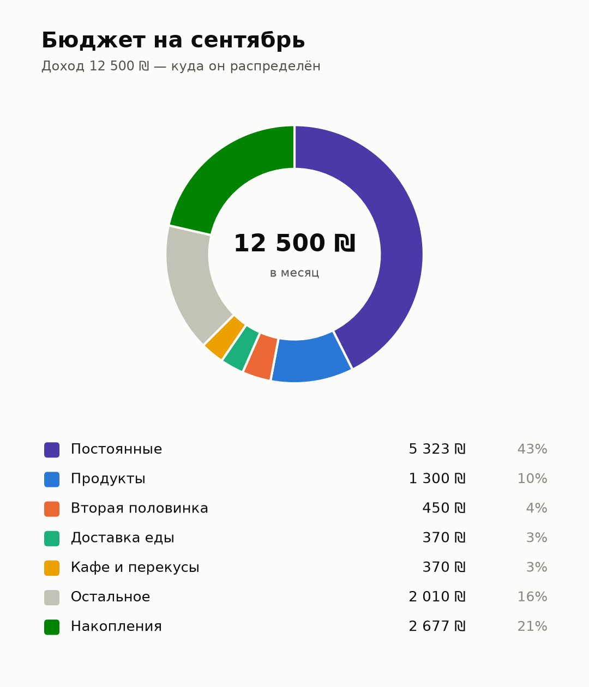
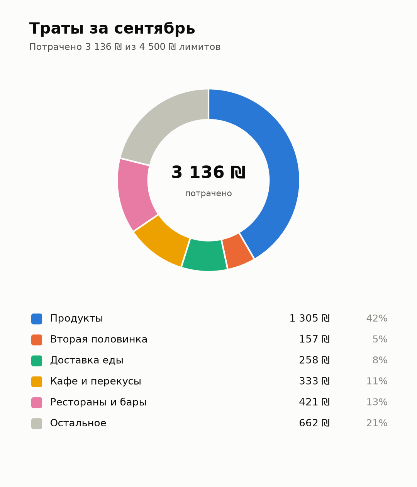

# 💰 Бот «Бюджет» — Telegram-трекер бюджета для молодых, пар и студентов

Бот составляет личный бюджет по короткой анкете, предлагает оптимальные лимиты по категориям,
записывает траты за пару секунд (`45 кофе`), ведёт всё в личной Excel-таблице, рисует круговые
диаграммы, каждую неделю присылает сводку и позволяет паре смотреть бюджеты друг друга.

- 📖 **[Пошаговый гайд по настройке и запуску](docs/SETUP_GUIDE.md)** — от @BotFather до сервера.
- 💡 **[Идеи и улучшения на оценку](docs/IDEAS.md)** — что можно добавить дальше.
- 📊 **[Пример Excel-таблицы](examples/budget_demo.xlsx)** с демо-данными.

## Возможности

**Первая настройка (анкета)** — 5 блоков, ответы кнопками или текстом, «⬅️ Назад» на каждом шаге:
1. Постоянные платежи: жильё, счета, арнона, подписки (`Netflix 50, Spotify 20`), другие ежемесячные списания.
2. Доход, день зарплаты, сколько на счету, кредитки: день списания и текущая сумма к списанию.
3. Основные траты: продукты, транспорт, здоровье, одежда.
4. Привычки: хобби, кафе, рестораны, доставка, сигареты/вейп, игры, вторая половинка, спонтанные
   покупки, непредвиденное, другие частые траты, свои категории, нюансы.
5. Цель накоплений — бот считает, сколько остаётся, и предлагает сумму.

**Анализ и оптимальный бюджет.** По ответам бот оценивает текущие траты в каждой категории,
показывает структуру (обязательное / желания / накопления против ориентира 50/30/20) и
наблюдения (еда вне дома, сигареты в год, доставка, подписки, минус на счёте и т.д.).
Затем предлагает лимиты: если на цель не хватает, дефицит снимается с «гибких» категорий
(доставка, спонтанные покупки, кафе) сильнее, чем с обязательных (продукты, транспорт), а
здоровье, учёба и резерв не урезаются. **В том же окне** можно нажать на категорию или цель и
написать свою сумму — бюджет пересчитается.

**Каждый день**
- Траты текстом: `45 кофе`, `wolt 89`, `1 200 шуферсаль`; доход: `+12000 зарплата`.
  Категория подбирается автоматически и запоминается; кнопки для смены категории/оплаты/суммы/даты.
- Задним числом: `вчера 45 кофе`, `25.09 120 продукты`, `25 сентября 120 продукты`.
- ⚠️ Отдельное предупреждение, когда категория дошла до 80% и 100% лимита (по желанию — и партнёру).
- 🌙 Вечернее напоминание, если за день ничего не записано (время настраивается).
- 📊 Бюджет месяца с прогресс-барами и дневным лимитом, 🥧 круговые диаграммы (план и факт),
  📋 история с правкой и удалением, 🏦 счёт и карты со сверкой баланса.
- Автоматически: постоянные платежи в их день, списание кредитки (перенос суммы с карты на счёт),
  зарплата в день зарплаты.
- 📬 Сводка в начале каждой недели: потрачено за неделю и с начала месяца, остаток и дневной
  лимит, превышенные категории, деньги на счету и сумма к списанию по картам.

**Excel** — у каждого пользователя своя таблица: Сводка (с формулами и диаграммами), Операции,
Бюджет, Постоянные, Карты, По месяцам, Анкета, Профиль. Бот берёт данные из неё; таблицу можно
скачать, отредактировать и прислать обратно.

**👫 Пара** — связь по приглашению: каждый видит бюджет, сводку, диаграмму, операции и таблицу
партнёра. У каждого остаётся свой бюджет.

**⚙️ Настройки** — уведомления (сводка, лимиты, партнёру, время напоминания), лимиты, названия и ключевые слова категорий, постоянные платежи (сумма, день,
способ оплаты, пауза), доход и день зарплаты, цель (с автоподгонкой лимитов), карты, сводки,
валюта, повторная анкета, удаление данных.

<p align="center">
  
  
</p>

## Быстрый старт

```bash
cd budget-bot
cp .env.example .env          # впиши BOT_TOKEN от @BotFather и свои Telegram ID
docker compose up -d --build  # или: python -m venv .venv && pip install -r requirements.txt && python -m budget_bot
```

Подробно, с вариантами для компьютера, сервера с Docker и без него — в [гайде](docs/SETUP_GUIDE.md).

## Как устроено

```
budget_bot/
  app.py           сборка приложения python-telegram-bot, запуск
  config.py        настройки из .env
  models.py        модель данных пользователя
  categories.py    стандартные категории, ключевые слова, автоопределение категории
  parsing.py       разбор «45 кофе», сумм, списков, дат
  planner.py       аналитика анкеты: оценки трат, подбор лимитов, наблюдения
  finance.py       статистика месяца, баланс счёта, карты, регулярные платежи
  excel_store.py   чтение/запись Excel (формулы с посчитанными значениями, диаграммы)
  registry.py      служебный реестр: пары, приглашения, настройки сводок
  charts.py        круговые диаграммы (PNG)
  reports.py       тексты отчётов и сводок
  alerts.py        предупреждения о лимитах (80% и 100%)
  jobs.py          ежедневная обработка, еженедельная сводка, вечернее напоминание
  handlers/        обработчики Telegram: анкета, траты, экраны, настройки, пара, Excel
tests/             unit-тесты и сквозные сценарии с имитацией Telegram API
```

- Python 3.11+, [python-telegram-bot](https://python-telegram-bot.org) 22 (long polling, JobQueue),
  XlsxWriter + openpyxl, matplotlib.
- Данные — в `DATA_DIR`: `users/<id>.xlsx` (главное хранилище), `registry.json`,
  `conversations.pickle`, `backups/`.
- Формулы в таблице сохраняются вместе с посчитанными ботом значениями, поэтому таблица
  правильно выглядит даже в превью на телефоне; тест пересчитывает все формулы в LibreOffice и
  сверяет результат с расчётами бота.

## Тесты

```bash
pip install -r requirements-dev.txt
pytest
```

Сквозные тесты проходят анкету, записывают траты, открывают все экраны, меняют настройки,
выгружают и загружают Excel, связывают пару и запускают фоновые задачи — на имитации Telegram
API, без сети.

Пересобрать пример таблицы и картинки диаграмм: `python scripts/make_demo.py`.
